<p align="center">
  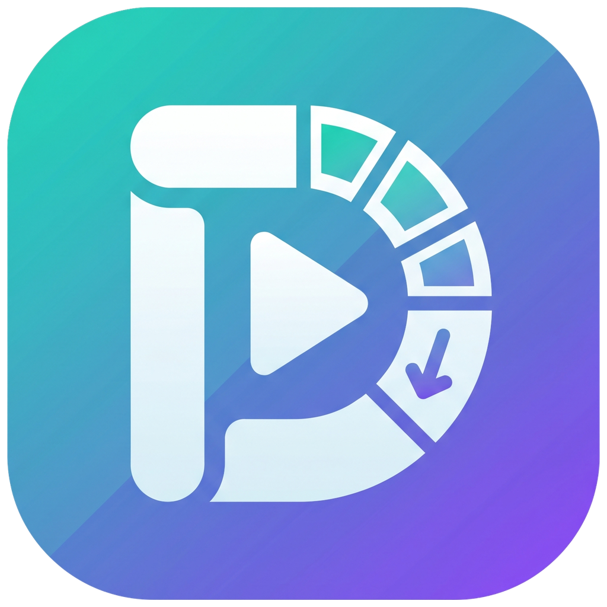
</p>

<h1 align="center">Dasharr</h1>

<p align="center">
  <strong>One dashboard for your whole media server.</strong><br>
  Radarr, Sonarr, Prowlarr, Bazarr, qBittorrent, Plex, Seerr, Tracearr and Beszel in a fast native app for Windows and Android.
</p>

<p align="center">
  <a href="https://github.com/Vitorsinc/Dasharr/releases/latest"></a>
  <a href="https://github.com/Vitorsinc/Dasharr/releases"></a>
  <a href="https://github.com/Vitorsinc/Dasharr/actions/workflows/ci.yml"></a>
  
  
  <a href="LICENSE"></a>
</p>

<p align="center">
  <a href="#download">Download</a> ·
  <a href="#features">Features</a> ·
  <a href="#screenshots">Screenshots</a> ·
  <a href="#getting-started">Getting started</a> ·
  <a href="#building-from-source">Build</a> ·
  <a href="docs/README.es.md">Leer en español</a>
</p>

<p align="center">
  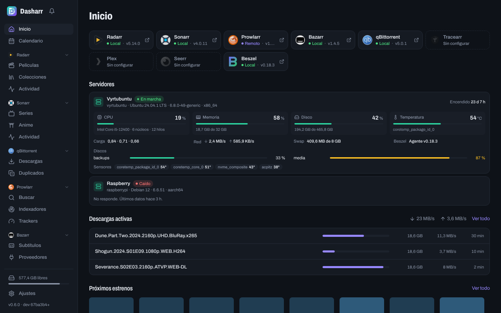
</p>

Dasharr brings the apps of a self-hosted media server together in one window, in the spirit of
[nzb360](https://nzb360.com) but for the desktop. Browse and manage your movie and series libraries,
follow downloads, search indexers, fix subtitles, approve requests and keep an eye on the server,
without juggling a dozen browser tabs. It talks directly to your services: there is no Dasharr
cloud, account or telemetry.

> [!NOTE]
> The interface is currently in **Spanish**.

## ✨ Highlights

- **Works at home and away.** Each service has a local and an external address. Dasharr uses the local
  one when it answers and switches to your domain or reverse proxy when it doesn't, like nzb360.
- **Ratings everywhere.** FilmAffinity, Letterboxd, IMDb, TMDb, Rotten Tomatoes, Metacritic, Trakt and
  TVDB scores on every poster and detail page, and you can sort your library by any of them.
- **Duplicate torrent cleaner.** Finds the torrents left behind when Radarr or Sonarr upgraded a release,
  shows which copy is in use, warns about unmet seeding times (hit & run) and frees the space in one
  click, without breaking cross-seeds.
- **Private tracker stats.** Ratio, buffer, bonus and H&R for your UNIT3D trackers, plus a live
  freeleech and double-upload list you can send straight to qBittorrent.
- **"What you've watched".** Plex watch history (via Tracearr) marks watched and in-progress titles on
  the posters and shows who watched each episode and when.
- **Same setup on PC and phone.** An optional, end-to-end encrypted copy of your configuration in your
  own Google Drive keeps Windows and Android in sync.
- **Updates itself.** New versions install automatically (verified with SHA-256), and an optional
  *Dasharr Dev* build tracks every change as it lands.

## 🧩 Supported services

| Service | What Dasharr does with it |
| --- | --- |
| **Radarr** | Movie library, add and search, interactive release search, queue and manual import, history and blocklist, collections, quality profiles, custom formats, tags, lists and exclusions, bulk edit |
| **Sonarr** | Series and a separate **Anime** section, seasons and episodes, per-season search and delete, the same management tools as Radarr |
| **qBittorrent** | Torrents with sortable, configurable columns, add by link or file, per-file priorities, speed limits, categories, completion notifications |
| **Prowlarr** | Search all indexers and send to qBittorrent, indexer health, add and test indexers, minimum seed time per tracker |
| **Bazarr** | Missing subtitles, manual search with scores, history, subtitle providers (enable, configure, unblock) |
| **Plex** | Sign in with your Plex account, now playing, recently added, server status, library scans and maintenance |
| **Seerr** | Requests (approve, decline, retry), Discover to request movies or seasons, issues and users |
| **Tracearr** | Watch history per user, who watched what and how far, watched marks in the library |
| **Beszel** | CPU, memory, disks, temperature, network, load and sensors of each server on the home page |
| **UNIT3D trackers** | Ratio, upload, download, buffer, bonus and H&R, read through the API keys you already have in Prowlarr |

<a id="features"></a>

## 🚀 Features

<details open>
<summary><strong>Home and calendar</strong></summary>

- Status and version of every service, with a button to open its web UI.
- Server stats from Beszel, active downloads with speeds, upcoming releases, Plex *now playing*,
  pending Seerr requests and a warning when duplicate torrents are wasting space.
- Free disk space always visible; click it to see every disk, turning yellow or red as they fill up.
- An error bell next to the logo collects failing services, failed actions and Radarr/Sonarr/Prowlarr/Bazarr
  health warnings.
- Weekly and monthly calendar of episodes and movie releases (cinema and digital), with three week
  layouts: agenda, posters and per day.
</details>

<details>
<summary><strong>Movies, series and anime</strong></summary>

- Poster grids with status, ratings and watched marks; filter by downloaded, missing, monitored, tag or
  watched state, and sort by title, date or any rating. Your sort order is remembered.
- Detail pages with the title's fanart as background, synopsis, quality, file, ratings, genres, Seerr
  requester, collection and download history.
- Automatic and interactive (manual) search for movies, seasons and episodes. Results can be sorted by any
  column, filtered with words (`-word` excludes) and show the subtitle languages each release carries.
- Edit quality profile and root folder (moving files), refresh, rescan, rename with preview, monitor whole
  seasons, delete single files or a whole season.
- Deleting a movie or series can also remove its torrents from qBittorrent, chosen one by one with tracker,
  ratio and seed time.
- **Wanted** tab with missing and cutoff-unmet items, searchable all at once.
- Bulk edit: select many posters and change monitoring, quality profile, tags or delete them together.
- Anime is detected automatically and added with its own root folder and profile.
- Radarr **Collections**: every saga, what you have, what's missing, and add or monitor them in one click.
</details>

<details>
<summary><strong>Downloads and indexers</strong></summary>

- qBittorrent list with sortable headers and a column picker (ratio, uploaded, seeds/peers, category,
  tracker, added, completed…), per-torrent details with files, trackers and peers.
- Windows notification when a download finishes, and the error reason for stalled torrents.
- **Duplicates** page for leftover torrents after upgrades, plus orphan torrents no *arr knows about.
- Prowlarr search across every indexer; when there is no magnet link Dasharr fetches the `.torrent` itself,
  so it also works from outside your network.
- Indexer health, enable/disable, test one or all, add new indexers with their full form, and set the
  minimum seed time per tracker.
- **Trackers** page for UNIT3D sites with stats and a freeleech list; sending a torrent also adds the movie
  or series to Radarr/Sonarr so it gets imported.
</details>

<details>
<summary><strong>Subtitles, Plex, requests and history</strong></summary>

- Bazarr: missing subtitles by language, manual search showing each provider's score, download history, and
  a **Providers** page to enable, configure and unblock subtitle providers.
- Plex: sign in without copying tokens, server status, library scans, empty trash and maintenance tasks.
- Seerr: approve or decline requests, discover trending and popular titles, request movies or single seasons
  (also in 4K, with profile and folder, or on behalf of another user), manage issues and user quotas.
- Tracearr: what is playing now and the full playback history, filterable by user and type.
</details>

<details>
<summary><strong>Settings and app</strong></summary>

- Per-service local and external URLs, API keys, and optional reverse-proxy Basic auth (sent only to the
  external address). Clear errors for wrong keys, missing base URLs and proxy logins.
- Radarr/Sonarr management (quality profiles, custom formats, tags, root folders, delay profiles, import
  lists and exclusions) inside each service's settings.
- Choose which ratings to show, your Plex user, default folders and profiles, light or dark theme.
- Built-in log viewer (API keys and passwords are never logged).
- Start with Windows, automatic updates with release notes, and a collapsible sidebar grouped by service,
  each section in its service's color.
- Phone layout on Android: bottom navigation bar, full-screen dialogs and card lists.
</details>

<a id="screenshots"></a>

## 📸 Screenshots

<table>
  <tr>
    <td width="50%">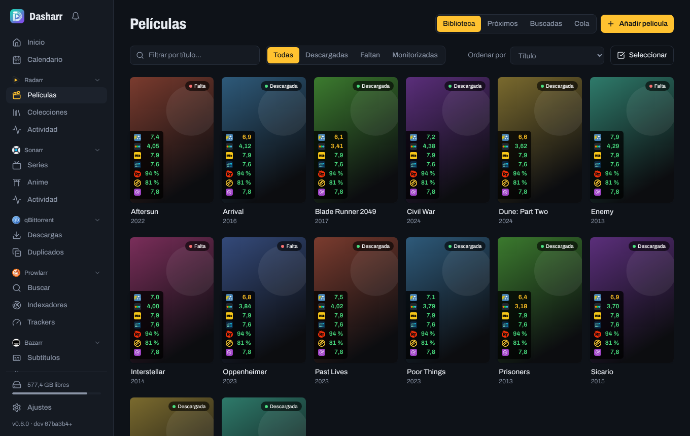<br><sub><b>Movies</b>: ratings from eight sites on every poster</sub></td>
    <td width="50%">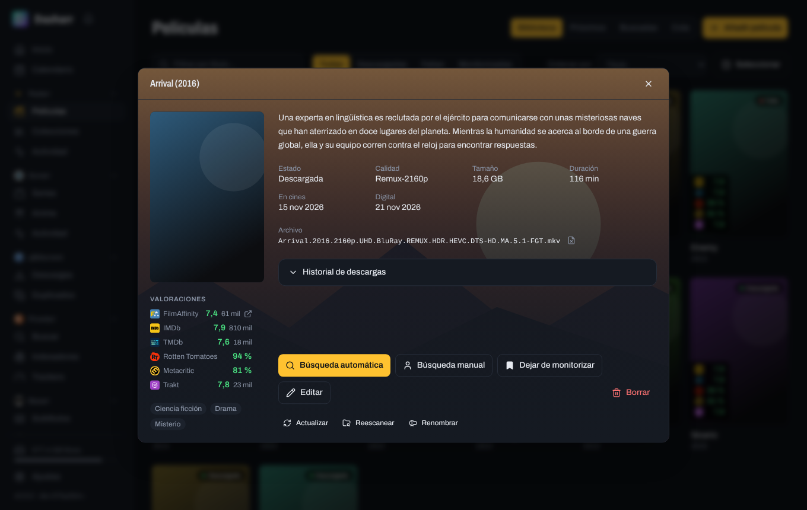<br><sub><b>Details</b>: fanart, file, ratings and one-click searches</sub></td>
  </tr>
  <tr>
    <td>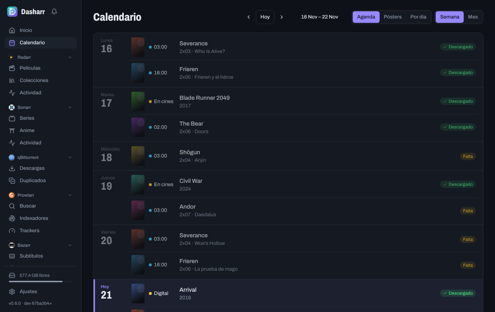<br><sub><b>Calendar</b>: agenda, posters or per-day week views</sub></td>
    <td>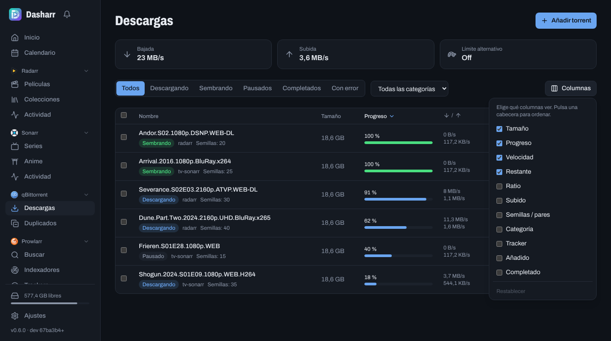<br><sub><b>Downloads</b>: sortable, configurable columns</sub></td>
  </tr>
  <tr>
    <td>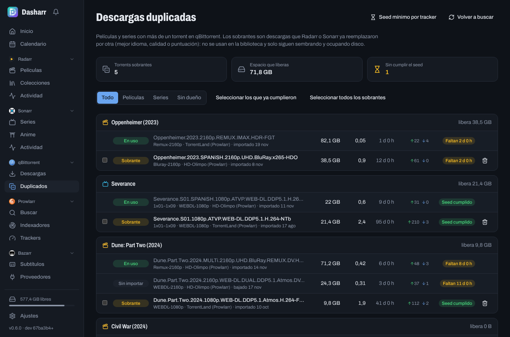<br><sub><b>Duplicates</b>: reclaim space from replaced releases</sub></td>
    <td>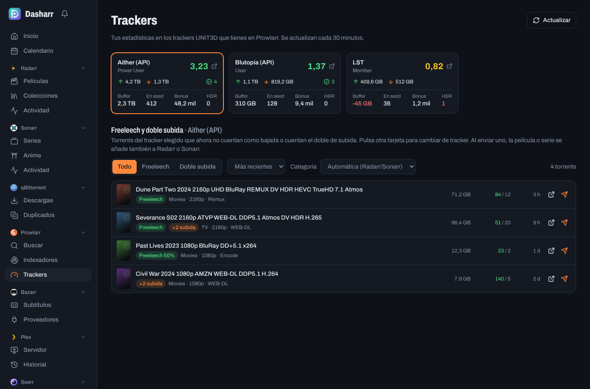<br><sub><b>Trackers</b>: ratio, buffer, bonus and freeleech</sub></td>
  </tr>
  <tr>
    <td>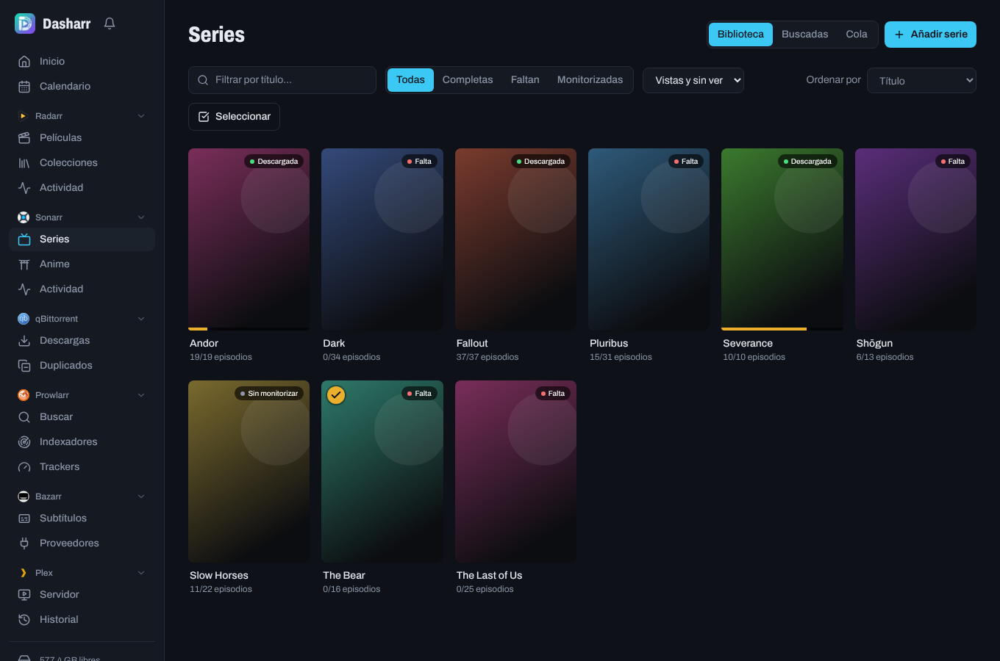<br><sub><b>Series</b>: watched and in-progress marks from Plex</sub></td>
    <td>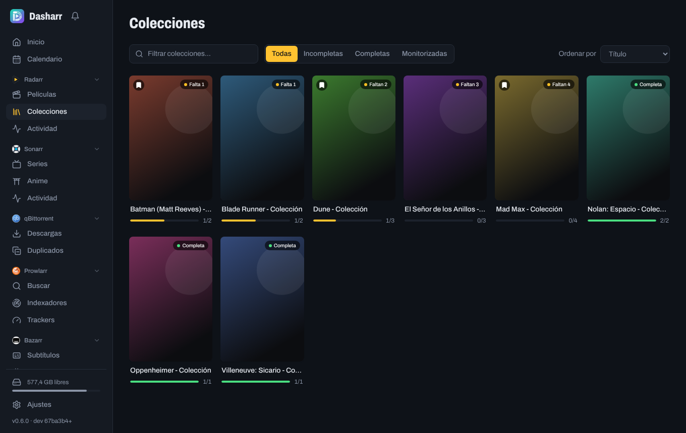<br><sub><b>Collections</b>: complete your sagas</sub></td>
  </tr>
  <tr>
    <td>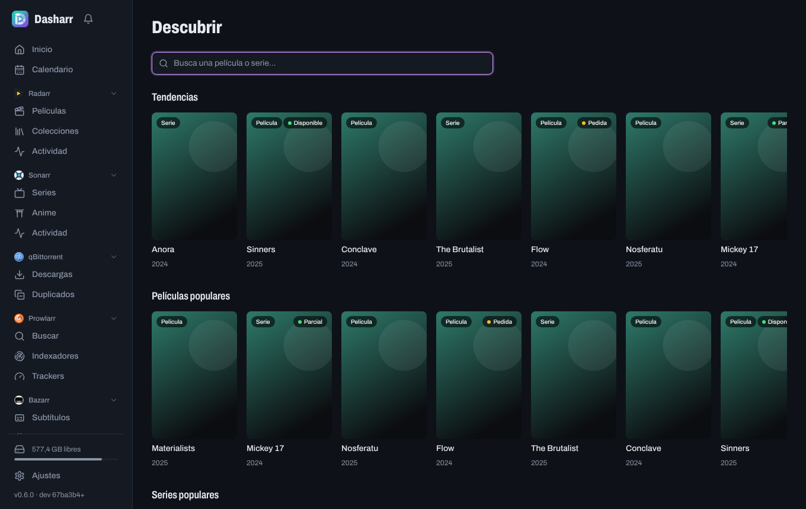<br><sub><b>Discover</b>: browse and request through Seerr</sub></td>
    <td>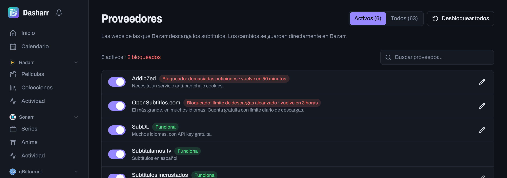<br><sub><b>Subtitle providers</b>: Bazarr without opening Bazarr</sub></td>
  </tr>
</table>

<p align="center">
  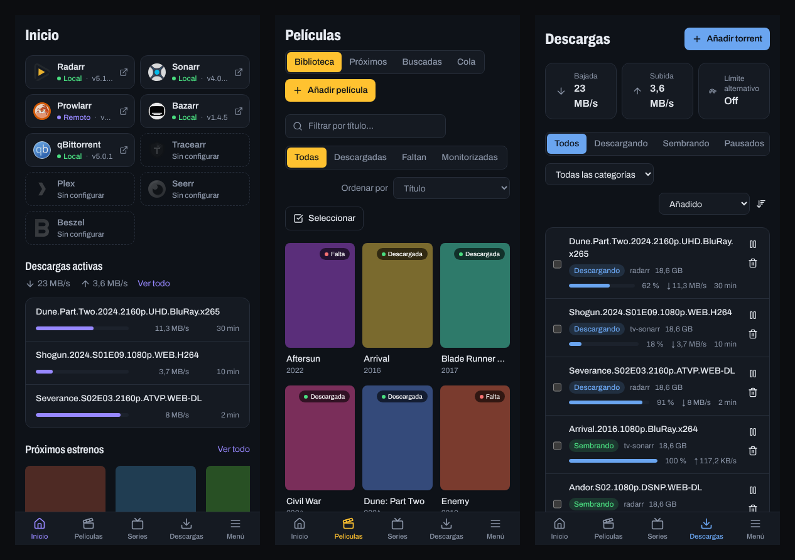<br>
  <sub><b>Android</b>: the same app, laid out for your phone</sub>
</p>

<a id="download"></a>

## 📥 Download

| Platform | File | Notes |
| --- | --- | --- |
| **Windows 10/11** (x64) | `Dasharr_<version>_x64-setup.exe` or `.msi` | From [Releases](https://github.com/Vitorsinc/Dasharr/releases/latest). Updates itself. |
| **Android 7+** (arm64) | `Dasharr_<version>_android.apk` | From [Releases](https://github.com/Vitorsinc/Dasharr/releases). Allow installing from your browser when asked. |

Every installer comes with a `.sha256` file so you can check the download. On Android, a new version is
offered inside the app and downloaded through the browser.

### Dasharr Dev (preview builds)

Every change merged into the `dev` branch is built automatically and published as the
[`dev-latest`](https://github.com/Vitorsinc/Dasharr/releases/tag/dev-latest) pre-release, for Windows and
Android. This build is called **Dasharr Dev** and installs **side by side** with Dasharr: it has its own
name, folder, shortcut and settings.

- On first launch it copies your Dasharr configuration; API keys and passwords are shared.
- It checks for a new build every 10 minutes and reinstalls itself (with 30 seconds to postpone).
- Preview builds are not code-signed.

<a id="getting-started"></a>

## 🛠 Getting started

1. Open **Ajustes** (Settings) → **Servicios**.
2. For each service, enter the **local address** (for example `http://192.168.1.50:7878`) and, if you use it
   away from home, the **external address** (for example `https://radarr.example.com`).
3. Paste the **API key** (in Radarr, Sonarr, Prowlarr and Bazarr: *Settings → General*). For qBittorrent use
   your Web UI username and password (or an API key on 5.2+). For Plex, click **Iniciar sesión con Plex**
   and pick your server.
4. If your reverse proxy asks for a username and password, open *Autenticación del proxy*.
5. Click **Probar conexión** (test) and then **Guardar** (save).

API keys and passwords are stored in the Windows Credential Manager (on Android, in the app's private
storage). You can also import an existing configuration from a file.

### ☁️ Sync with Google (optional)

**Ajustes → Cuenta de Google** keeps the same configuration on your PC and phone. Sign in with Google and
choose a password: Dasharr saves your services, keys and preferences to its **private app folder** in your
Google Drive (it cannot see your other files), encrypted with AES-256-GCM using a key derived from your
password, which never leaves your devices. It syncs on its own while Dasharr is open. Technical details:
[docs/google.md](docs/google.md).

## 🔒 Privacy

Dasharr has no server of its own, collects no usage statistics and sends nothing to its authors. It only
connects to the services you configure, to Plex and Google if you sign in to them, to GitHub to check for
updates, and to public movie sites (TMDb, Letterboxd, FilmAffinity) using only a title or ID. The full list
is in [PRIVACY.md](PRIVACY.md).

<a id="code-signing-policy"></a>

## ✍️ Code signing policy

Free code signing provided by [SignPath.io](https://about.signpath.io), certificate by [SignPath Foundation](https://signpath.org)

- Only the installers of published releases are signed: the ones on
  [Releases](https://github.com/Vitorsinc/Dasharr/releases), built by GitHub Actions
  (`.github/workflows/release.yml`) from this repository. Dasharr Dev preview builds are not signed.
- Committers and reviewers: [Vitorsinc](https://github.com/Vitorsinc). Changes arrive by pull request to
  `dev` and reach `master` only after Vitorsinc reviews them.
- Approvers (every signing request is approved manually in SignPath): [Vitorsinc](https://github.com/Vitorsinc).

**Privacy policy:** this program will not transfer any information to other networked systems unless
specifically requested by the user or the person installing or operating it. See [PRIVACY.md](PRIVACY.md).

<a id="building-from-source"></a>

## 🧑‍💻 Building from source

Dasharr is built with [Tauri 2](https://tauri.app) (Rust) and React + TypeScript + Tailwind.

**Requirements:** Node.js LTS, Rust (stable) and, on Windows, the Visual Studio C++ build tools:

```powershell
winget install Git.Git OpenJS.NodeJS.LTS Rustlang.Rustup
winget install Microsoft.VisualStudio.2022.BuildTools --override "--quiet --add Microsoft.VisualStudio.Workload.VCTools --includeRecommended"
```

```bash
npm install
npm run tauri dev            # run the app in development mode
npm test                     # UI tests (Vitest)
cargo test -p dasharr-core   # network core tests
npm run tauri build          # Windows installer
scripts/build-android.sh     # Android APK (needs the Android SDK and NDK)
```

On Windows, `scripts\dasharr-dev.bat` pulls the latest `dev` and starts Dasharr in development mode, using
the same configuration as the installed app.

**Project layout**

```
src/             React UI (pages, components, API clients, i18n)
src-tauri/       Tauri app: commands, secrets, updater, Android project
crates/          dasharr-core: HTTP client with local/external switching
docs/            Design notes, API references and screenshots
```

**Branches:** every change goes through a pull request to `dev`, where it is tested (and published as
Dasharr Dev). `master` only receives reviewed changes through a `dev → master` pull request, and releases
(`vX.Y.Z`) are tagged on `master`. See [CHANGELOG.md](CHANGELOG.md) for the release history.

## 🙏 Acknowledgements

Dasharr is an independent project and is not affiliated with any of the services it connects to. Thanks to
the teams behind [Radarr](https://radarr.video), [Sonarr](https://sonarr.tv), [Prowlarr](https://prowlarr.com),
[Bazarr](https://www.bazarr.media), [qBittorrent](https://www.qbittorrent.org), [Plex](https://www.plex.tv),
[Seerr](https://github.com/seerr-team/seerr), Tracearr,
[Beszel](https://beszel.dev) and [UNIT3D](https://github.com/HDInnovations/UNIT3D-Community-Edition),
and to [nzb360](https://nzb360.com) for the inspiration. Movie and series data from
[TMDb](https://www.themoviedb.org) (this product uses the TMDB API but is not endorsed or certified by TMDB).

## 📄 License

[MIT](LICENSE) © Vitorsinc
