

  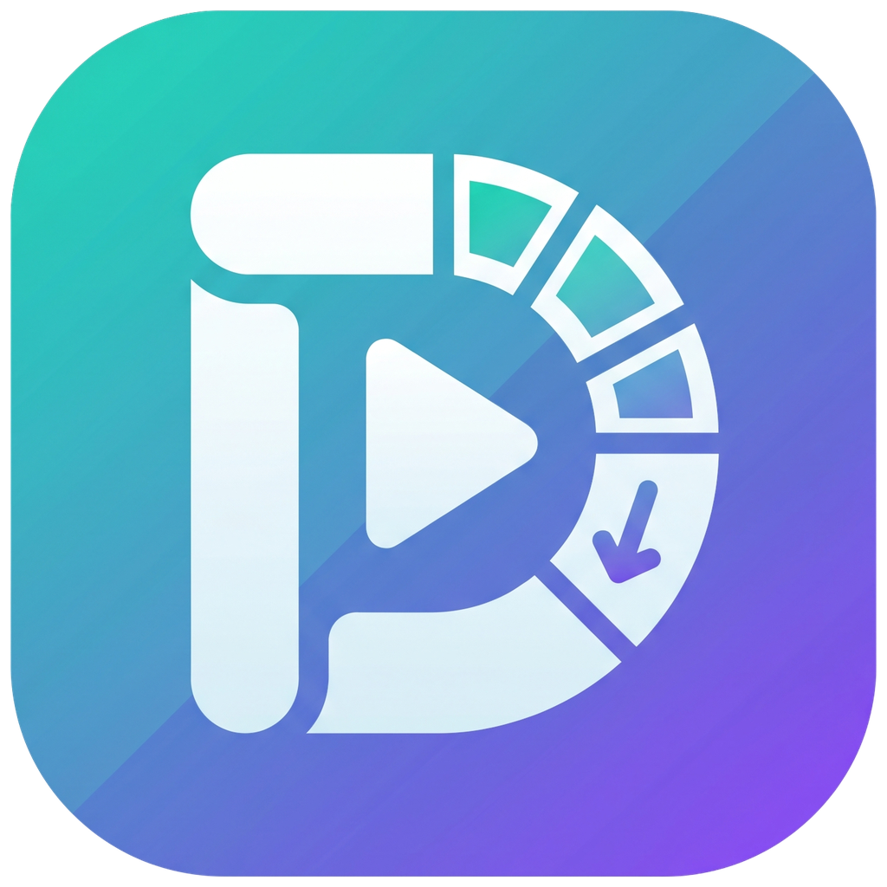

<h1 align="center">Dasharr</h1>

  <strong>Un solo panel para todo tu servidor multimedia.</strong> 
  Radarr, Sonarr, Prowlarr, Bazarr, qBittorrent, Plex, Seerr, Tracearr y Beszel en una app nativa y rápida para Windows y Android.

  
  
  

  <a href="../README.md">English</a> ·
  <a href="#descargar">Descargar</a> ·
  <a href="#funciones">Funciones</a> ·
  <a href="#capturas">Capturas</a> ·
  <a href="#primeros-pasos">Primeros pasos</a>

  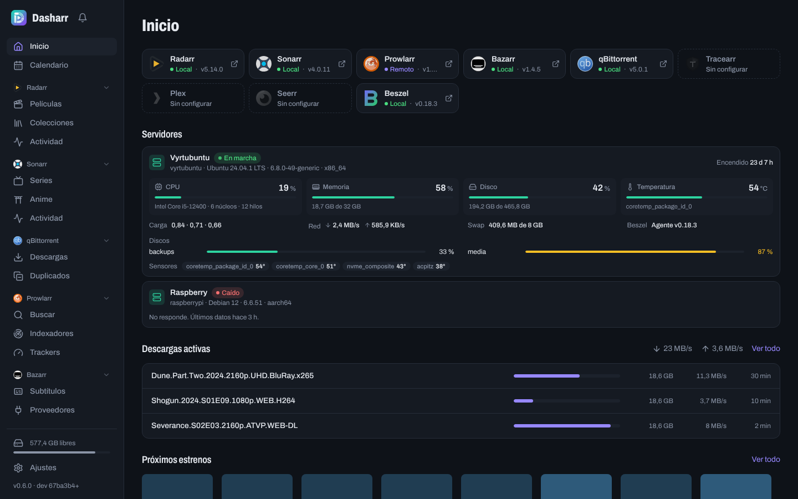

Dasharr reúne en una sola ventana las aplicaciones de un servidor multimedia casero, al estilo de
[nzb360](https://nzb360.com) pero para escritorio. Gestiona tus películas y series, sigue las descargas,
busca en los indexadores, arregla subtítulos, aprueba solicitudes y vigila el servidor sin tener una
docena de pestañas abiertas. Habla directamente con tus servicios: no hay nube, cuenta ni estadísticas
de Dasharr.

## ✨ Lo más destacado

- **Funciona en casa y fuera.** Cada servicio tiene dirección local y externa: Dasharr usa la local cuando
  responde y cambia sola a tu dominio o proxy inverso cuando no.
- **Notas en todas partes.** FilmAffinity, Letterboxd, IMDb, TMDb, Rotten Tomatoes, Metacritic, Trakt y TVDB
  en cada póster y ficha, y puedes ordenar la biblioteca por cualquiera de ellas.
- **Limpieza de torrents duplicados.** Encuentra los torrents que sobran cuando Radarr o Sonarr bajan una
  versión mejor, marca cuál está en uso, avisa del seed mínimo (H&R) y libera el espacio de un clic sin
  romper el cross-seed.
- **Estadísticas de trackers privados.** Ratio, buffer, bonus y H&R de tus trackers UNIT3D, y una lista de
  freeleech y doble subida que se manda directa a qBittorrent.
- **«Lo que has visto».** El historial de Plex (vía Tracearr) marca en los pósters lo visto y lo empezado, y
  dice quién vio cada episodio y cuándo.
- **La misma configuración en el PC y el móvil**, con una copia cifrada en tu propio Google Drive.
- **Se actualiza solo**, y la versión de prueba *Dasharr Dev* recibe cada cambio en cuanto entra.

## 🧩 Servicios compatibles

| Servicio | Qué hace Dasharr con él |
| --- | --- |
| **Radarr** | Biblioteca de películas, añadir y buscar, búsqueda manual de releases, cola e importación manual, historial y bloqueadas, colecciones, perfiles, formatos, etiquetas, listas y exclusiones, edición masiva |
| **Sonarr** | Series y una sección aparte de **Anime**, temporadas y episodios, buscar y borrar por temporada, la misma gestión que Radarr |
| **qBittorrent** | Torrents con columnas ordenables y configurables, añadir por enlace o archivo, prioridad por archivo, límites de velocidad, categorías, aviso al terminar |
| **Prowlarr** | Buscar en todos los indexadores y mandar a qBittorrent, estado de los indexadores, añadirlos y probarlos, seed mínimo por tracker |
| **Bazarr** | Subtítulos que faltan, búsqueda manual con puntuación, historial y proveedores (activar, configurar, desbloquear) |
| **Plex** | Inicio de sesión con tu cuenta, reproduciendo ahora, añadido recientemente, estado del servidor, escaneo y mantenimiento |
| **Seerr** | Solicitudes (aprobar, rechazar, reintentar), Descubrir para pedir películas o temporadas, incidencias y usuarios |
| **Tracearr** | Historial de reproducciones por usuario, quién vio qué y hasta dónde, marcas de visto en la biblioteca |
| **Beszel** | CPU, memoria, discos, temperatura, red, carga y sensores de cada servidor en Inicio |
| **Trackers UNIT3D** | Ratio, subido, bajado, buffer, bonus y H&R con las claves que ya tienes en Prowlarr |

## 🚀 Funciones

- **Inicio:** estado de cada servicio, servidores (Beszel), descargas activas, próximos estrenos, Plex,
  solicitudes pendientes y aviso de duplicados. Espacio en disco siempre visible y campanita de errores.
- **Calendario** semanal y mensual, con la semana en Agenda, Pósters o Por día.
- **Películas, Series y Anime:** pósters con notas y marcas de visto, filtros y orden que se recuerda;
  fichas con fondo, archivo, notas, historial y quién lo pidió en Seerr; búsqueda automática y manual
  (ordenable, con filtro de palabras e idiomas de subtítulos); editar perfil y carpeta, renombrar, borrar un
  archivo o una temporada entera (y sus torrents); pestaña «Buscadas»; edición masiva; **Colecciones**.
- **Descargas:** columnas a elegir, ficha de cada torrent, aviso de Windows al terminar y página
  **Duplicados**. **Buscar** en Prowlarr, **Indexadores** y **Trackers** con su lista de freeleech.
- **Subtítulos y Proveedores** de Bazarr, **Plex**, **Solicitudes** y **Descubrir** de Seerr e **Historial** de Tracearr.
- **Ajustes:** direcciones local y externa, API keys, usuario del proxy, gestión de Radarr y Sonarr, notas
  visibles, tema claro u oscuro, registro, inicio con Windows y actualizaciones automáticas.
- **Android:** barra inferior, diálogos a pantalla completa y listas en tarjetas.

## 📸 Capturas

<table>
  <tr>
    <td width="50%">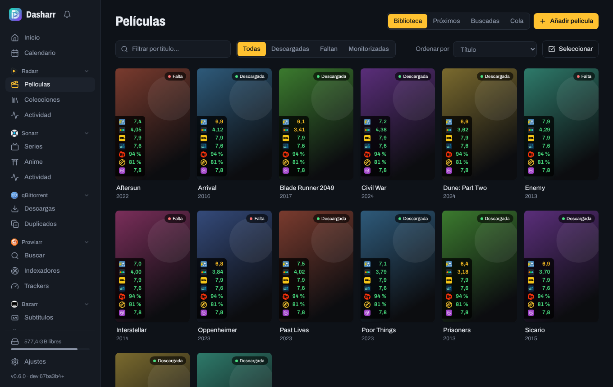 <b>Películas</b>: notas de ocho webs en cada póster</td>
    <td width="50%">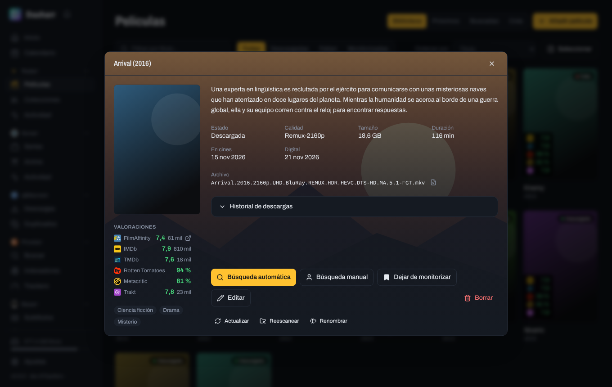 <b>Ficha</b>: fondo, archivo, notas y búsquedas</td>
  </tr>
  <tr>
    <td>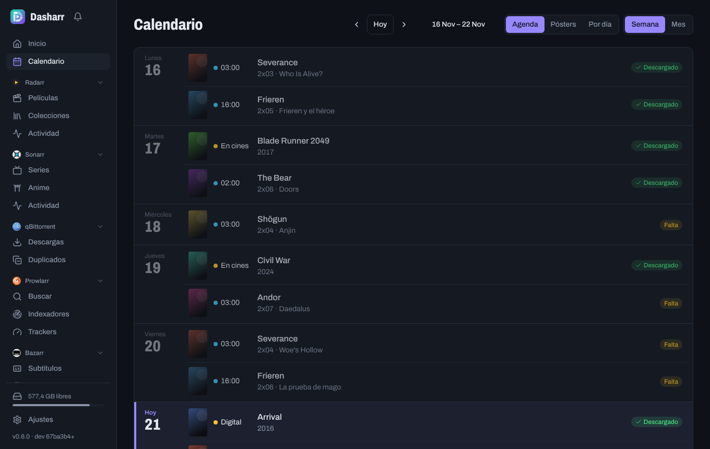 <b>Calendario</b>: Agenda, Pósters o Por día</td>
    <td>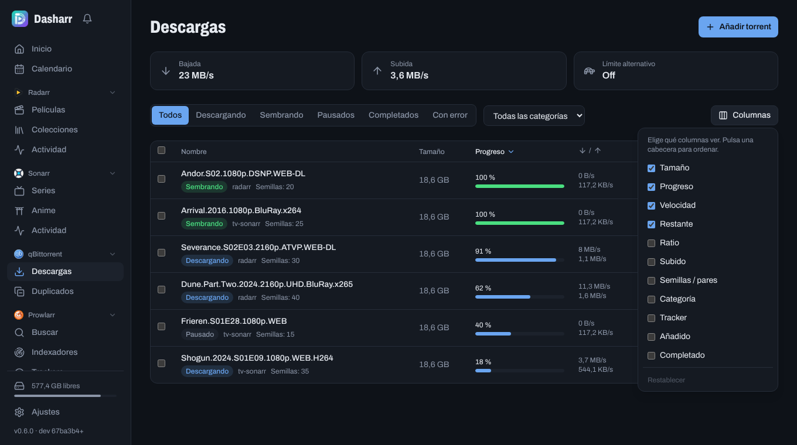 <b>Descargas</b>: columnas ordenables y a elegir</td>
  </tr>
  <tr>
    <td>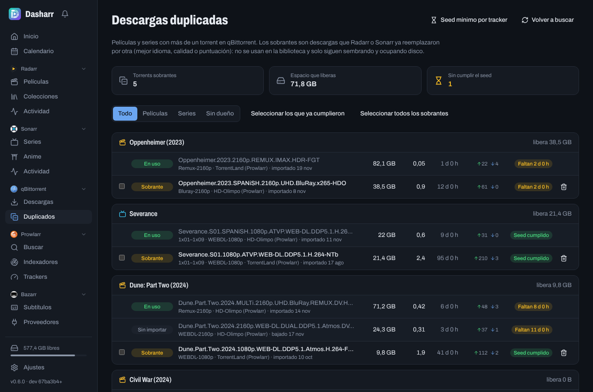 <b>Duplicados</b>: recupera espacio tras las mejoras</td>
    <td>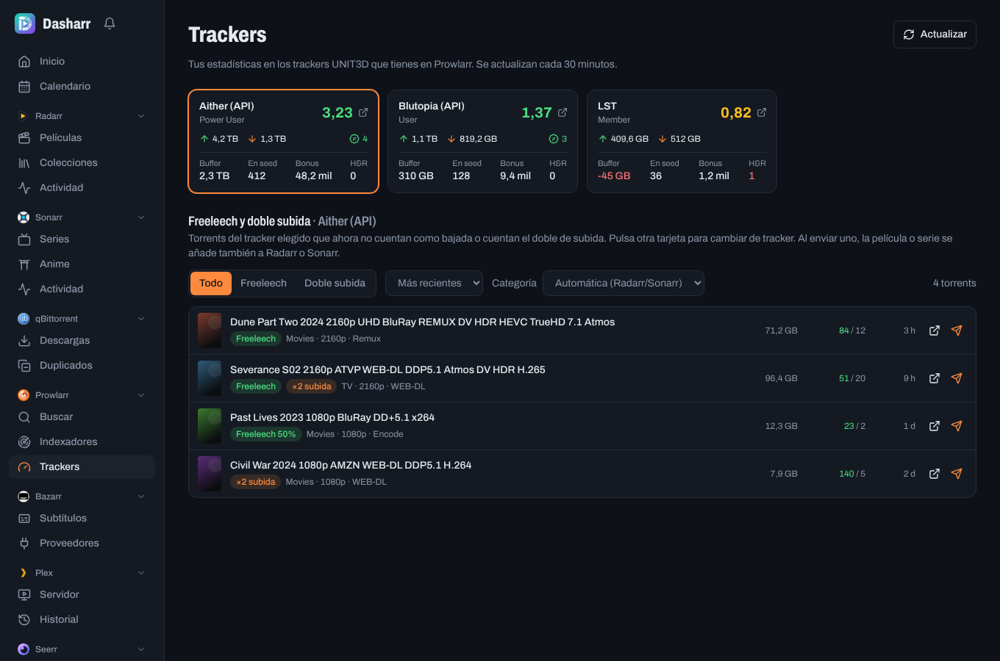 <b>Trackers</b>: ratio, buffer, bonus y freeleech</td>
  </tr>
  <tr>
    <td>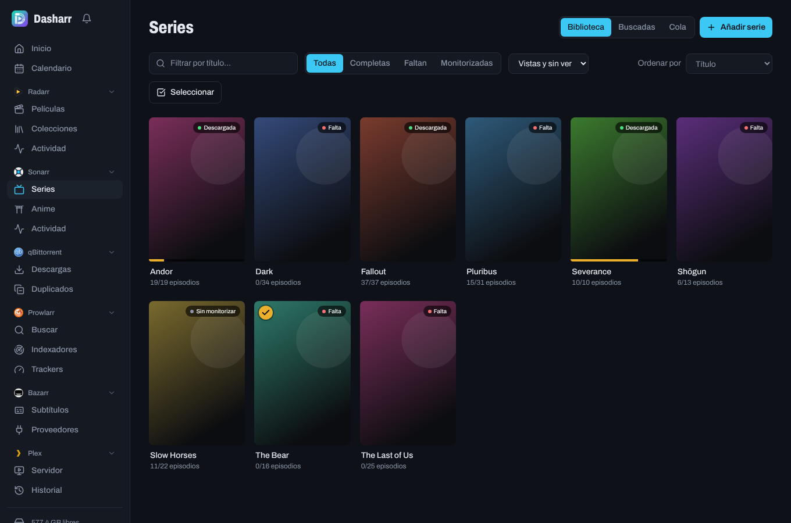 <b>Series</b>: lo visto y lo empezado en Plex</td>
    <td>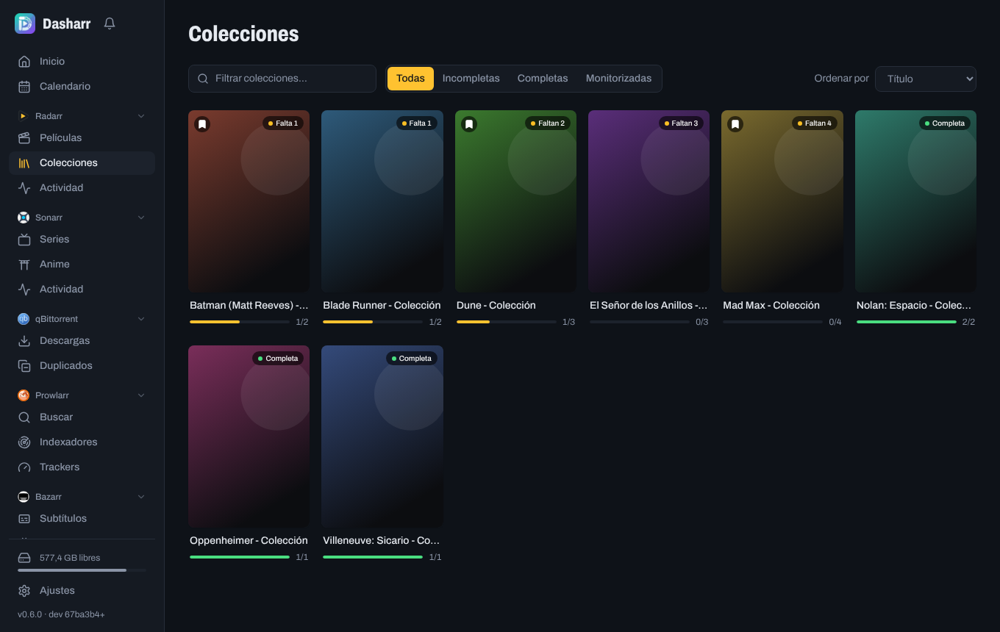 <b>Colecciones</b>: completa tus sagas</td>
  </tr>
  <tr>
    <td>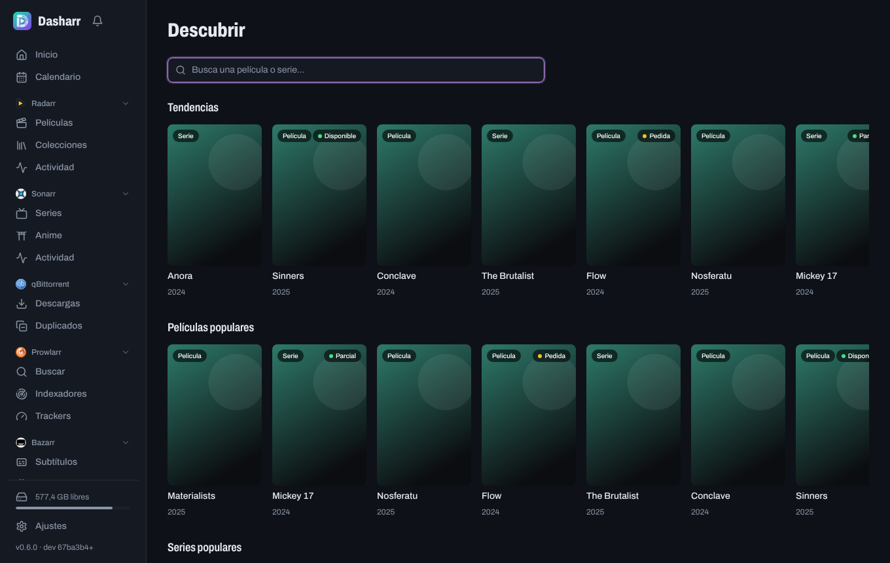 <b>Descubrir</b>: explora y pide con Seerr</td>
    <td>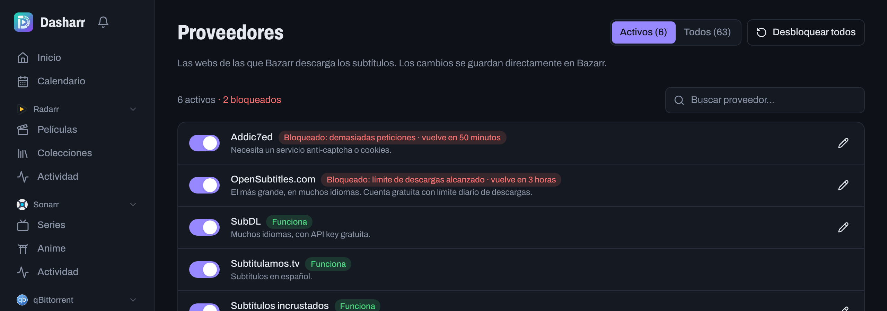 <b>Proveedores</b>: Bazarr sin abrir Bazarr</td>
  </tr>
</table>

  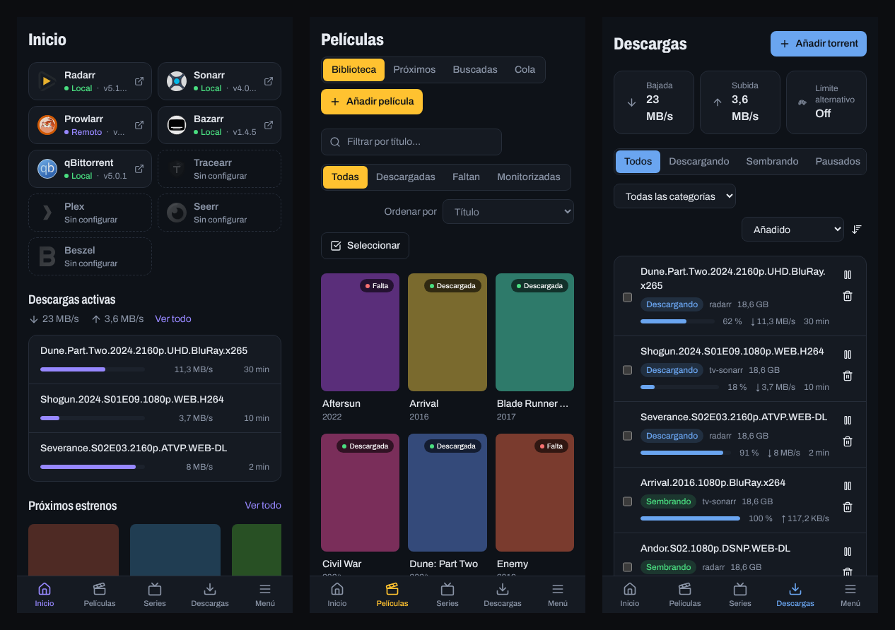 
  <b>Android</b>: la misma app, adaptada al móvil

## 📥 Descargar

| Plataforma | Archivo | Notas |
| --- | --- | --- |
| **Windows 10/11** (x64) | `Dasharr_<versión>_x64-setup.exe` o `.msi` | En [Releases](https://github.com/Vitorsinc/Dasharr/releases/latest). Se actualiza solo. |
| **Android 7+** (arm64) | `Dasharr_<versión>_android.apk` | En [Releases](https://github.com/Vitorsinc/Dasharr/releases). Permite instalar desde el navegador cuando lo pida. |

Cada instalador lleva su archivo `.sha256` para comprobar la descarga.

**Dasharr Dev:** cada cambio de la rama `dev` se publica solo en la Release
[`dev-latest`](https://github.com/Vitorsinc/Dasharr/releases/tag/dev-latest) (Windows y Android). Se instala
junto a Dasharr sin tocarlo, copia su configuración la primera vez, mira cada 10 minutos si hay cambios y se
reinstala sola. Cada versión de prueba lleva un número que sube con cada cambio (por ejemplo `v0.6.0 · dev 233`). No va firmada.

## 🛠 Primeros pasos

1. Abre **Ajustes → Servicios**.
2. Para cada servicio rellena la **dirección local** (por ejemplo `http://192.168.1.50:7878`) y, si lo usas
   fuera de casa, la **dirección externa** (por ejemplo `https://radarr.midominio.com`).
3. Pega la **API key** (en Radarr, Sonarr, Prowlarr y Bazarr está en *Settings → General*). En qBittorrent
   usa el usuario y la contraseña de la interfaz web (o una API key en la 5.2+). En Plex pulsa
   **Iniciar sesión con Plex** y elige tu servidor.
4. Si tu proxy inverso pide usuario y contraseña, despliega *Autenticación del proxy*.
5. Pulsa **Probar conexión** y después **Guardar**.

Las claves se guardan en el Administrador de credenciales de Windows (en Android, en la carpeta privada de
la app).

**Copia en Google (opcional):** en **Ajustes → Sistema → Sincronización con Google** inicias sesión y eliges una contraseña.
Dasharr guarda servicios, claves y preferencias en su carpeta privada de tu Google Drive (no ve el resto de
tus archivos), cifrados con AES-256-GCM con esa contraseña, que no sale de tus dispositivos. Detalles en
[google.md](google.md).

## 🔒 Privacidad y firma

Dasharr no tiene servidor propio, no recoge estadísticas y no envía datos a sus autores. Ver
[PRIVACY.md](../PRIVACY.md). Las versiones publicadas se firman gratis con SignPath Foundation; la política
completa está en la sección [Code signing policy](../README.md#code-signing-policy) del README.

## 🧑‍💻 Compilar

Ver [Building from source](../README.md#building-from-source). Licencia [MIT](../LICENSE).
